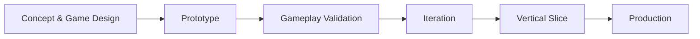

<div align="center">

# ⚔️ SAMURAI KUROHANE

### A 2.5D samurai-futurist action metroidvania by **JM Game Studios**


**Tradition. Steel. Legacy.**

</div>

---

## 📖 About the project

**Samurai Kurohane** is an original videogame project in development at **JM Game Studios**.

The project is being designed as a **2.5D action metroidvania** with a dark, cinematic, samurai-futurist identity. Its world combines the visual language of Japanese warrior culture with futuristic architecture, technology, crimson energy, rain-soaked districts, monumental temples and hostile territories built around exploration, precision combat and progression.

The current protagonist is **Akio Kurohane**, heir to the legacy of the vanished **Kurohane Clan**.

The project is currently in the **prototype / pre-production stage**. Systems, narrative details, visuals, balance and content shown in the repository are subject to change as the game evolves.

> **Samurai Kurohane is not intended to imitate an existing game.**  
> Its goal is to establish an original identity, world, characters, combat language and intellectual property for JM Game Studios.

---

## 🥷 Akio Kurohane

Akio is the playable protagonist of **Samurai Kurohane**.

He is envisioned as a disciplined, agile and precise swordsman carrying the legacy of a clan that has disappeared from the world. His design combines traditional samurai influences with a darker futuristic silhouette:

- wide **kasa**
- black and charcoal armor
- layered cloth and weathered cloak
- crimson clan iconography
- technologically enhanced katana
- restrained red energy accents
- elegant rather than excessively bulky armor
- strong silhouette for side-view gameplay

Akio's gameplay philosophy is built around one principle:

> **Akio does not win through brute force. He wins through discipline, timing and precision.**

---

## 🌑 World & atmosphere

The current visual direction establishes a world built around:

- futuristic Japanese districts
- monumental imperial architecture
- pagodas and fortress silhouettes
- torii gates
- blackened metal and dark wood
- crimson banners
- blood-red moonlight
- rain
- wet reflective surfaces
- canals and layered city depth
- atmospheric fog
- cinematic contrast between black, charcoal and crimson

The first prototype environment is the **Imperial District**, currently used to test:

- composition
- traversal scale
- combat readability
- camera framing
- lighting
- environmental depth
- player silhouette
- visual hierarchy

---

## 🎮 Gameplay direction

**Genre:** Action Metroidvania  
**Perspective:** 2.5D side view  
**Combat focus:** Precision, timing, posture pressure and sword mastery  
**Exploration:** Ability-gated progression and interconnected environments  
**Tone:** Dark, cinematic, technological and samurai-inspired

### Core gameplay pillars

| Pillar | Direction |
|---|---|
| ⚔️ Sword Combat | Fast but deliberate katana combat |
| 🛡️ Defense | Guard, posture management and timing-based parry |
| 💨 Mobility | Responsive running, jumping and dash movement |
| 🧭 Exploration | Metroidvania traversal and ability-gated paths |
| 🩸 Progression | Combat techniques, movement abilities and clan arts |
| 🌧️ Atmosphere | Cinematic environments with strong visual identity |
| 👺 Encounters | Enemy patterns designed around reading and counterplay |

---

## ⚔️ Current prototype combat

The active gameplay prototype is focused on validating Akio's core combat feel before final characters and animations are produced.

### Implemented / prototyped

- player movement
- jump
- dash
- brief dash evasion window
- three-hit light attack combo
- heavy attack
- guard
- timing-based parry
- health
- posture
- guard break
- defeat and respawn loop
- attack hit detection
- prototype enemy combat target
- enemy attack telegraph
- enemy health and posture
- enemy posture break
- enemy defeat and respawn
- runtime prototype HUD

### Prototype controls

#### Keyboard & mouse

| Action | Input |
|---|---|
| Move | **A / D** or **Left / Right** |
| Jump | **Space** |
| Dash | **Left Shift** |
| Light Attack | **J** / Left Mouse |
| Heavy Attack | **K** / Right Mouse |
| Parry | **Q** |
| Guard | **L** |

#### Gamepad

| Action | Input |
|---|---|
| Move | Left Stick |
| Jump | South Button |
| Dash | East Button |
| Light Attack | West Button |
| Heavy Attack | North Button |
| Parry | Left Shoulder |
| Guard | Left Trigger |

> Control mapping is still considered **prototype configuration** and may change.

---

## 🧠 Combat philosophy

The combat system is being designed around **intentional decisions instead of button mashing**.

A skilled Akio player should be able to:

1. read an enemy attack;
2. position correctly;
3. use dash deliberately;
4. defend or parry at the correct moment;
5. pressure enemy posture;
6. punish an opening;
7. break posture;
8. execute a decisive counterattack.

The planned combat language includes techniques such as:

### Kirisame
A rapid offensive sword technique intended for short-range pressure and fast punishment.

### Tsukiyomi
A mobility-oriented technique envisioned as an advanced phantom-like displacement that can support both combat and traversal.

### Kurenai
A powerful crimson sword technique designed around burst damage and high posture damage.

These systems are part of the design direction and may evolve during prototyping.

---

## 📊 Posture system

Both Akio and enemies are being designed around a **Posture** mechanic.

### Akio

Blocking reduces incoming health damage but damages posture.

If posture reaches zero:

- Akio suffers a **Guard Break**;
- movement and defense are temporarily compromised;
- the enemy gains a punish window.

### Enemies

Attacks, heavy strikes and successful parries damage enemy posture.

When enemy posture is broken:

- the enemy becomes vulnerable;
- Akio gains a high-value offensive window;
- future iterations may trigger finishers or executions.

---

## 🗺️ Metroidvania progression

The long-term progression model is planned around abilities that affect both **combat and traversal**.

Potential progression directions include:

- double jump
- air dash
- wall traversal
- advanced parry techniques
- counter slash
- charged iai attacks
- clan techniques
- environmental seals
- hidden paths
- Kurohane relic interactions
- movement abilities that open previously inaccessible areas

The final progression tree has **not yet been locked**.

---

## 🎨 Art direction

**Samurai Kurohane** follows the visual direction of JM Game Studios:

- modern
- AAA-inspired
- technological
- minimalist where appropriate
- cinematic
- professional
- dark and mature
- non-cartoon presentation

### Core palette

| Role | Color direction |
|---|---|
| Primary Darkness | Black / Charcoal |
| Energy / Clan | Crimson Red |
| Materials | Dark Steel / Leather / Wood |
| Secondary FX | Controlled warm orange |
| UI / Contrast | White / Neutral light values |

The visual language should preserve gameplay readability even inside dark environments.

---

## 🏯 Imperial District prototype

The first major environment prototype is the **Imperial District**.

It currently explores:

- 2.5D combat lane
- blood moon
- distant pagoda skyline
- elevated imperial palace
- bridge traversal
- canals
- torii structures
- Kurohane banners
- lantern networks
- crimson gardens
- atmospheric rain
- wet-surface reflections
- layered foreground and background depth
- player readability lighting

The prototype is intentionally **geometry-first**. Unity primitives and runtime-generated materials are being used to validate gameplay and composition before replacing them with authored production assets.

---

## 🛠️ Technology stack

The repository currently uses:

| Technology | Version / Role |
|---|---|
| **Unity** | 6000.6.1f1 |
| **Universal Render Pipeline** | 17.6.0 |
| **C#** | Gameplay and tools |
| **Unity Input System** | 1.20.0 |
| **AI Navigation** | 2.0.14 |
| **Timeline** | 6.6.0 |
| **Visual Scripting** | 1.9.12 |
| **Unity Test Framework** | 1.8.0 |
| **Git / GitHub** | Version control |
| **Visual Studio / Rider** | Development environment |

Future production may also incorporate tools such as:

- Blender
- Substance 3D Painter
- FMOD or Wwise
- dedicated VFX workflows
- authored animation pipelines

No external production dependency should be considered final until it is formally adopted by the project.

---

## 🧱 Project architecture

The repository currently follows standard Unity project organization.

```text
SamuraiKurohane/
├── Assets/
│   ├── Scenes/
│   ├── Settings/
│   ├── SamuraiKurohane/          # Project-specific gameplay/prototype content
│   └── InputSystem_Actions.inputactions
│
├── Packages/
│   ├── manifest.json
│   └── packages-lock.json
│
├── ProjectSettings/
│
├── Build-Windows.ps1             # Prototype Windows build helper
├── .gitignore
└── README.md
```

### Prototype branch

The active gameplay/environment work is currently developed in:

```text
feature/imperial-district-prototype
```

with its integration tracked in **Pull Request #1**.

Important prototype files include:

```text
Assets/SamuraiKurohane/Prototype/
├── ImperialDistrictPrototype.cs
├── AkioPrototypeController.cs
├── PrototypeCombatTarget.cs
└── README.md
```

and the prototype scene:

```text
Assets/Scenes/ImperialDistrict_Prototype.unity
```

---

## 🚀 Getting started

### Requirements

- Unity Hub
- **Unity 6000.6.1f1**
- Git
- Windows is currently the primary development target

### Clone

```bash
git clone https://github.com/Jairo0811/SamuraiKurohane.git
cd SamuraiKurohane
```

For the current prototype:

```bash
git checkout feature/imperial-district-prototype
```

Then open the repository folder through **Unity Hub**.

Allow Unity to restore packages before entering Play Mode.

---

## ▶️ Running the prototype

On the prototype branch:

1. Open Unity.
2. Open:

```text
Assets/Scenes/ImperialDistrict_Prototype.unity
```

3. Wait for compilation/import to finish.
4. Press **Play**.
5. The environment, Akio prototype and Training Samurai are generated at runtime.

---

## 🪟 Windows prototype build

The development branch contains a prototype Windows x64 build workflow.

### From Unity

Use:

```text
JM Game Studios
→ Build
→ Windows Prototype (.exe)
```

### Output

```text
Builds/
└── Windows/
    └── SamuraiKurohanePrototype/
        └── SamuraiKurohanePrototype.exe
```

### PowerShell alternative

```powershell
.\Build-Windows.ps1
```

The Windows Player pipeline is still being validated during the prototype stage, including URP shader inclusion and build configuration.

---

## 🌿 Branch strategy

Current branches:

| Branch | Purpose |
|---|---|
| `main` | Stable project baseline |
| `feature/imperial-district-prototype` | Imperial District + Akio gameplay prototype |

Feature development should remain isolated from `main` until the relevant prototype milestone is validated.

---

## 🗓️ Development roadmap

### Foundation

- [x] Unity project created
- [x] Universal Render Pipeline configured
- [x] Input System available
- [x] GitHub repository established

### Prototype environment

- [x] Imperial District blockout
- [x] 2.5D presentation
- [x] bridge combat lane
- [x] palace / skyline composition
- [x] torii and lantern language
- [x] rain atmosphere
- [x] crimson lighting/readability passes

### Akio gameplay prototype

- [x] movement
- [x] jump
- [x] dash
- [x] light combo
- [x] heavy attack
- [x] guard
- [x] parry
- [x] health
- [x] posture
- [x] training combat target
- [ ] final character model
- [ ] production animation set
- [ ] animation-driven hitboxes
- [ ] polished hit-stop and combat VFX
- [ ] Kurenai
- [ ] Tsukiyomi
- [ ] Kirisame

### Vertical slice

- [ ] authored Imperial District environment assets
- [ ] first production enemy archetypes
- [ ] final HUD direction
- [ ] audio implementation
- [ ] music direction
- [ ] save/checkpoint system
- [ ] progression prototype
- [ ] first complete encounter
- [ ] first boss prototype
- [ ] vertical-slice polish pass

---

## 🧪 Prototype philosophy

The repository deliberately prioritizes **mechanics and readability before production art**.

The current workflow is:



A mechanic should prove that it is enjoyable and readable before significant production resources are committed to it.

---

## 🤖 Use of AI

JM Game Studios may use AI-assisted tools as part of the creative, technical and production workflow.

AI can support areas such as:

- brainstorming
- design exploration
- concept development
- prototyping
- programming assistance
- documentation
- UI exploration
- storyboards
- production planning

However:

> **Creative direction, canon, gameplay decisions, project scope, artistic identity and quality control remain under human direction.**

The project should not be presented as a game “made by AI”. AI is treated as a support tool, not as a substitute for authorship or creative direction.

---

## 🎮 About JM Game Studios

**JM Game Studios** is an independent game-development brand focused on building original intellectual properties, immersive worlds, strong gameplay systems and cinematic presentation.

The studio's long-term direction is to create original games with:

- distinctive identities
- strong narrative foundations
- responsive gameplay
- professional production standards
- ambitious worlds scaled responsibly for independent development

**Samurai Kurohane** is one of the original IPs being developed under this vision.

---

## 👤 Project direction

**Creator / Project Direction:** Jairo Matías  
**Studio:** JM Game Studios

The project is being developed incrementally from prototype toward a future vertical slice.

---

## ⚠️ Development status

This repository contains **work in progress**.

Expect:

- placeholder geometry
- debug UI
- temporary values
- incomplete systems
- prototype-only code
- changing combat balance
- unfinished visual assets
- experimental build tooling

Nothing in the current prototype should be interpreted as final production quality or final game content.

---

## 📜 Intellectual property & licensing

**Samurai Kurohane**, its original characters, world concepts, terminology, visual identity and associated JM Game Studios material are part of an original project under development.

This repository currently does **not** include an open-source license.

Unless an explicit license is added later, the source code, game concepts and project assets should **not** be assumed to be licensed for redistribution, commercial reuse, derivative works or incorporation into other products.

Third-party packages remain subject to their respective licenses and terms.

---

## ⭐ Project goal

The immediate objective is not to build the entire game at once.

The next major target is:

> **A polished vertical slice that demonstrates Akio, the combat identity, traversal, the Imperial District art direction and the quality bar of Samurai Kurohane.**

---

<div align="center">

### ⚔️ SAMURAI KUROHANE

**An original JM Game Studios project**

*Built one system, one encounter and one world layer at a time.*

</div>
