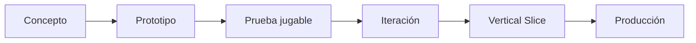

<div align="center">

# ⚔️ SAMURAI KUROHANE

### Metroidvania de acción 2.5D samurái-futurista de **JM Game Studios**

<p align="center">
  
  
  
</p>

<p align="center">
  
  
  
  
</p>

<p align="center">
  
  
  
  
</p>

<p align="center">
  <strong>Unity · C# · URP · Input System · Git · GitHub · Visual Studio / Rider</strong>
</p>

**Tradición. Acero. Legado.**

</div>

---

## 📖 Sobre el proyecto

**Samurai Kurohane** es una propiedad intelectual original en desarrollo bajo **JM Game Studios**.

El proyecto está concebido como un **metroidvania de acción 2.5D** con una identidad samurái-futurista oscura, cinematográfica y tecnológica. Su mundo combina influencias visuales del Japón feudal con arquitectura futurista, energía carmesí, lluvia, distritos imperiales, templos monumentales y sistemas de combate centrados en precisión, lectura del enemigo y dominio de la espada.

El protagonista es **Akio Kurohane**, heredero de un clan desaparecido cuyo legado define buena parte de la identidad narrativa y jugable del proyecto.

Actualmente el juego se encuentra en una etapa de **prototipo / preproducción**. Los sistemas, valores de balance, arte, narrativa y estructura del mundo todavía pueden cambiar durante la evolución del proyecto.

> **Samurai Kurohane no busca copiar videojuegos existentes.**  
> El objetivo es desarrollar una IP propia con identidad, personajes, mundo, combate y dirección artística originales.

---

## 🥷 Akio Kurohane

Akio Kurohane es el protagonista jugable.

Su diseño mezcla disciplina samurái, tecnología y una estética oscura y elegante.

### Rasgos visuales principales

- kasa amplio
- armadura negra y carbón
- placas metálicas oscuras
- cuero y telas envejecidas
- detalles carmesí
- capa larga y deteriorada
- iconografía del Clan Kurohane
- katana con energía roja controlada
- silueta clara para gameplay lateral

La filosofía jugable de Akio se resume en:

> **Akio no gana por fuerza bruta; gana por disciplina, timing y precisión.**

---

## 🌑 Mundo y atmósfera

La dirección visual actual se apoya en:

- distritos japoneses futuristas
- palacios imperiales
- fortalezas y pagodas
- torii
- canales
- lluvia constante
- superficies mojadas
- reflejos rojos
- niebla
- luna carmesí
- metal ennegrecido
- madera oscura
- jardines rojos
- iluminación cinematográfica
- profundidad por capas

El primer escenario prototipado es el **Imperial District**.

---

## 🏯 Imperial District

El **Imperial District** es el primer entorno de prueba importante del proyecto.

Actualmente permite validar:

- escala
- composición
- lectura visual
- desplazamiento lateral
- combate
- iluminación
- cámara
- siluetas
- profundidad ambiental
- contraste entre personaje y entorno
- identidad samurái-futurista

El prototipo utiliza geometría básica y materiales generados en runtime para acelerar iteraciones antes de crear assets definitivos.

---

## 🎮 Género y jugabilidad

**Género:** Metroidvania de acción  
**Perspectiva:** 2.5D lateral  
**Combate:** técnico, rápido y deliberado  
**Exploración:** rutas interconectadas y progresión por habilidades  
**Tono:** oscuro, serio, tecnológico y cinematográfico

### Pilares jugables

| Pilar | Dirección |
|---|---|
| ⚔️ Combate | Katana, combos, ataques pesados y contraataques |
| 🛡️ Defensa | Guardia, postura y parry |
| 💨 Movilidad | Correr, salto, dash y habilidades futuras |
| 🧭 Exploración | Estructura metroidvania y rutas bloqueadas por habilidades |
| 🩸 Progresión | Técnicas, movilidad y artes del clan |
| 🌧️ Atmósfera | Presentación visual fuerte y cinematográfica |
| 👺 Enemigos | Patrones legibles, castigo y ventanas de oportunidad |

---

## ⚔️ Combate actual del prototipo

El prototipo jugable ya incluye:

- movimiento lateral
- salto
- dash
- pequeña ventana de evasión durante el dash
- combo ligero de 3 golpes
- ataque pesado
- guardia
- parry basado en timing
- vida
- postura
- ruptura de guardia
- derrota y respawn
- detección de golpes
- enemigo de entrenamiento
- telegraph de ataque enemigo
- vida y postura enemiga
- posture break enemigo
- respawn del enemigo
- HUD de depuración

---

## 🎮 Controles del prototipo

### Teclado y mouse

| Acción | Control |
|---|---|
| Movimiento | **A / D** o Flechas izquierda/derecha |
| Salto | **Espacio** |
| Dash | **Shift izquierdo** |
| Ataque ligero | **J** / clic izquierdo |
| Ataque pesado | **K** / clic derecho |
| Parry | **Q** |
| Guardia | **L** |

### Gamepad

| Acción | Control |
|---|---|
| Movimiento | Stick izquierdo |
| Salto | Botón Sur |
| Dash | Botón Este |
| Ataque ligero | Botón Oeste |
| Ataque pesado | Botón Norte |
| Parry | Shoulder izquierdo |
| Guardia | Trigger izquierdo |

> Estos controles todavía pertenecen a la fase de prototipo y pueden cambiar.

---

## 🧠 Filosofía del combate

La intención es evitar un sistema basado únicamente en presionar botones rápidamente.

El combate de Akio debe recompensar:

1. observar;
2. medir distancia;
3. leer ataques;
4. reposicionarse;
5. usar dash con intención;
6. defender;
7. hacer parry;
8. castigar;
9. romper postura;
10. ejecutar un contraataque decisivo.

---

## 🩸 Sistema de postura

Tanto Akio como los enemigos utilizan un sistema de **Posture**.

### Akio

Bloquear reduce el daño directo a la vida, pero consume postura.

Cuando la postura llega a cero:

- ocurre un **Guard Break**;
- Akio queda vulnerable temporalmente;
- el enemigo obtiene una ventana para castigarlo.

### Enemigos

Los ataques, golpes fuertes y parries reducen postura enemiga.

Cuando la postura enemiga se rompe:

- el enemigo queda expuesto;
- Akio obtiene una ventana ofensiva;
- futuras versiones podrán activar finishers o ejecuciones.

---

## 🔥 Técnicas planeadas

### Kirisame

Técnica ofensiva rápida basada en múltiples cortes cortos y presión cercana.

### Tsukiyomi

Técnica de movilidad avanzada basada en desplazamiento veloz y reposicionamiento.

### Kurenai

Técnica carmesí de alto impacto, diseñada para infligir gran daño y daño de postura.

Estas técnicas todavía están sujetas a iteración.

---

## 🗺️ Progresión metroidvania

El sistema de progresión futuro puede incluir:

- doble salto
- air dash
- wall jump
- wall traversal
- parry mejorado
- counter slash
- iai cargado
- técnicas del clan
- ruptura de sellos
- interacción con reliquias Kurohane
- accesos ocultos
- rutas bloqueadas por habilidades

La estructura definitiva de progresión todavía no está cerrada.

---

# 🛠️ Stack tecnológico actual

Este es el stack que **ya forma parte del proyecto** o está directamente integrado en el repositorio.

<p align="center">
  
</p>

<p align="center">
  
  
  
  
  
  
</p>

| Tecnología | Versión / Uso |
|---|---|
| **Unity** | 6000.6.1f1 |
| **C#** | Gameplay, lógica, sistemas y herramientas |
| **Universal Render Pipeline (URP)** | 17.6.0 |
| **Unity Input System** | 1.20.0 |
| **Unity AI Navigation** | 2.0.14 |
| **Unity Timeline** | 6.6.0 |
| **Unity Visual Scripting** | 1.9.12 |
| **Unity Test Framework** | 1.8.0 |
| **Unity UI / UGUI** | UI y soporte de interfaz |
| **Git** | Control de versiones |
| **GitHub** | Repositorio, ramas, commits y pull requests |
| **Windows x64** | Plataforma principal del prototipo actual |

---

# 💻 Programas y herramientas de desarrollo

<p align="center">
  
  
  
  
  
</p>

## Herramientas usadas actualmente

### 🎮 Unity 6

Motor principal del proyecto.

Se utiliza para:

- gameplay
- escenas
- físicas
- iluminación
- materiales
- partículas
- input
- cámara
- prototipos
- builds
- testing

### 💻 Visual Studio / JetBrains Rider

Entornos de desarrollo para trabajar con:

- C#
- scripts de gameplay
- herramientas internas
- depuración
- arquitectura del proyecto

El repositorio incluye soporte para ambos mediante los paquetes oficiales de Unity.

### 🐙 GitHub

Se utiliza para:

- control de versiones
- ramas de desarrollo
- historial de commits
- pull requests
- revisión de cambios
- respaldo remoto
- evolución del proyecto

### 🔧 Git

Base del flujo de trabajo de control de versiones.

---

## Herramientas previstas para producción

<p align="center">
  
  
  
  
</p>

Estas herramientas forman parte de la dirección técnica prevista de **JM Game Studios**, pero no todas están integradas todavía en el prototipo actual.

### 🧊 Blender

Previsto para:

- modelado 3D
- blockouts avanzados
- escenarios
- props
- personajes
- armas
- UVs
- rigging auxiliar
- exportación hacia Unity

### 🎨 Substance 3D Painter

Previsto para:

- texturizado PBR
- materiales de armadura
- metal
- cuero
- madera
- desgaste
- suciedad
- superficies mojadas

### 🔊 FMOD

Posible middleware de audio para:

- música adaptativa
- sonido dinámico
- eventos de combate
- ambientación
- mezcla avanzada

### 🔊 Wwise

Alternativa posible a FMOD para:

- implementación de audio
- estados dinámicos
- música
- efectos
- integración profesional de sonido

> **FMOD y Wwise son alternativas de evaluación.**  
> No se plantea utilizar ambos simultáneamente como requisito del proyecto.

### 🎬 Herramientas futuras de animación y cinemática

Dependiendo de la producción, el proyecto podrá incorporar herramientas adicionales para:

- captura de movimiento
- animación
- edición de cinemáticas
- VFX
- composición
- audio
- producción de trailers

---

## 🧩 Paquetes Unity actuales

El proyecto incluye actualmente:

```text
com.unity.ai.navigation        2.0.14
com.unity.inputsystem          1.20.0
com.unity.render-pipelines.universal 17.6.0
com.unity.test-framework       1.8.0
com.unity.timeline             6.6.0
com.unity.ugui                 2.6.0
com.unity.visualscripting      1.9.12
```

Además del soporte estándar de Unity para:

- físicas 3D
- físicas 2D
- partículas
- animación
- audio
- UI
- shaders
- navegación
- vídeo
- XR

---

## 🎨 Dirección artística

La identidad visual de **Samurai Kurohane** sigue la dirección general de **JM Game Studios**:

- moderna
- tecnológica
- minimalista
- cinematográfica
- seria
- profesional
- inspirada en estándares AAA
- sin estética infantil ni caricaturesca

### Paleta principal

| Función | Color |
|---|---|
| Base | Negro |
| Material oscuro | Carbón |
| Clan / Energía | Carmesí |
| Metal | Acero oscuro |
| Contraste | Blanco |
| Iluminación secundaria | Naranja cálido controlado |

---

## 🧱 Estructura del proyecto

```text
SamuraiKurohane/
├── Assets/
│   ├── Scenes/
│   ├── Settings/
│   ├── SamuraiKurohane/
│   │   ├── Prototype/
│   │   └── Editor/
│   └── InputSystem_Actions.inputactions
│
├── Packages/
│   ├── manifest.json
│   └── packages-lock.json
│
├── ProjectSettings/
│
├── Build-Windows.ps1
├── .gitignore
└── README.md
```

---

## 🌿 Ramas del repositorio

Actualmente el repositorio utiliza:

| Rama | Uso |
|---|---|
| `main` | Base estable del proyecto |
| `feature/imperial-district-prototype` | Entorno Imperial District + gameplay de Akio |

El desarrollo activo del prototipo se mantiene separado de `main` hasta completar su validación.

---

## 📁 Archivos principales del prototipo

```text
Assets/SamuraiKurohane/Prototype/
├── ImperialDistrictPrototype.cs
├── AkioPrototypeController.cs
├── PrototypeCombatTarget.cs
└── README.md
```

Escena principal del prototipo:

```text
Assets/Scenes/ImperialDistrict_Prototype.unity
```

---

## 🚀 Cómo abrir el proyecto

### Requisitos

- Unity Hub
- Unity **6000.6.1f1**
- Git
- Windows para el prototipo actual

### Clonar

```bash
git clone https://github.com/Jairo0811/SamuraiKurohane.git
cd SamuraiKurohane
```

Para trabajar con el prototipo actual:

```bash
git checkout feature/imperial-district-prototype
```

Luego abrir la carpeta desde **Unity Hub**.

---

## ▶️ Ejecutar el prototipo

1. Abrir Unity.
2. Abrir:

```text
Assets/Scenes/ImperialDistrict_Prototype.unity
```

3. Esperar a que termine la compilación.
4. Presionar **Play**.
5. El entorno, Akio y el Training Samurai se generan en runtime.

---

## 🪟 Compilar para Windows

El proyecto contiene un flujo de build de prototipo para Windows x64.

### Desde Unity

```text
JM Game Studios
→ Build
→ Windows Prototype (.exe)
```

### Salida esperada

```text
Builds/
└── Windows/
    └── SamuraiKurohanePrototype/
        └── SamuraiKurohanePrototype.exe
```

### Alternativa PowerShell

```powershell
.\Build-Windows.ps1
```

La pipeline de Windows todavía se encuentra en fase de validación, especialmente en lo referente a configuración URP, shaders y empaquetado del Player.

---

## 🗓️ Roadmap

### Base técnica

- [x] Proyecto Unity creado
- [x] Unity 6 configurado
- [x] URP
- [x] Input System
- [x] Git
- [x] GitHub

### Imperial District

- [x] blockout 2.5D
- [x] puente de combate
- [x] skyline
- [x] palacio
- [x] torii
- [x] linternas
- [x] lluvia
- [x] jardines carmesí
- [x] contraste de gameplay

### Akio Gameplay Prototype

- [x] movimiento
- [x] salto
- [x] dash
- [x] combo ligero
- [x] ataque pesado
- [x] guardia
- [x] parry
- [x] vida
- [x] postura
- [x] enemigo de entrenamiento
- [ ] modelo 3D final de Akio
- [ ] animaciones finales
- [ ] hitboxes sincronizadas por animación
- [ ] hit-stop pulido
- [ ] VFX de combate
- [ ] Kurenai
- [ ] Tsukiyomi
- [ ] Kirisame

### Vertical Slice

- [ ] assets definitivos del Imperial District
- [ ] primer enemigo de producción
- [ ] HUD final
- [ ] audio
- [ ] música
- [ ] checkpoints
- [ ] guardado
- [ ] progresión
- [ ] primer encuentro completo
- [ ] primer boss
- [ ] polish pass

---

## 🧪 Filosofía de prototipado

El proyecto prioriza primero:



La idea es validar si una mecánica funciona y se siente bien antes de invertir tiempo en arte final.

---

## 🤖 Uso de IA

JM Game Studios utiliza la IA como **herramienta de apoyo creativo, técnico y productivo**.

Puede ayudar en:

- brainstorming
- documentación
- concept art
- storyboards
- prototipos
- programación asistida
- UI
- narrativa
- planificación
- materiales de presentación

Sin embargo:

> **La dirección creativa, el canon, la jugabilidad, el alcance, la identidad artística y el control de calidad permanecen bajo criterio humano.**

El proyecto no debe presentarse como un videojuego “hecho por IA”.

---

## 🎮 Sobre JM Game Studios

**JM Game Studios** es un estudio independiente en desarrollo enfocado en:

- videojuegos originales
- nuevas propiedades intelectuales
- mundos inmersivos
- narrativa
- gameplay
- diseño de personajes
- experiencias de alta calidad
- acabados profesionales inspirados en estándares AAA

Samurai Kurohane forma parte de esta visión.

---

## 👤 Dirección del proyecto

**Creador / Dirección del proyecto:** Jairo Matías  
**Estudio:** JM Game Studios

---

## ⚠️ Estado actual

Este repositorio está en desarrollo.

Actualmente puede contener:

- placeholders
- geometría temporal
- UI de debug
- código experimental
- valores de prueba
- mecánicas incompletas
- materiales temporales
- herramientas de build en validación

Nada de lo mostrado en esta etapa debe considerarse contenido final.

---

## 📜 Propiedad intelectual

**Samurai Kurohane**, Akio Kurohane, el Clan Kurohane, sus conceptos originales, personajes, mundo, identidad visual y demás contenido original pertenecen al proyecto desarrollado bajo JM Game Studios.

Actualmente el repositorio **no contiene una licencia open source**.

Por tanto, salvo que se añada una licencia explícita posteriormente:

- el código no debe asumirse como reutilizable libremente;
- los assets no deben redistribuirse;
- los conceptos no deben utilizarse comercialmente;
- no se autoriza la creación de trabajos derivados basándose en este repositorio.

Las dependencias y paquetes de terceros mantienen sus propias licencias.

---

## ⭐ Objetivo principal

El objetivo inmediato no es construir el juego completo de una sola vez.

La meta actual es:

> **Crear un vertical slice pulido que demuestre a Akio, el combate, la exploración, el Imperial District y el nivel de calidad visual y jugable que quiere alcanzar Samurai Kurohane.**

---

<div align="center">

# ⚔️ SAMURAI KUROHANE

### Una propiedad intelectual original de JM Game Studios

**Construyendo el juego sistema por sistema, encuentro por encuentro y mundo por mundo.**

</div>
